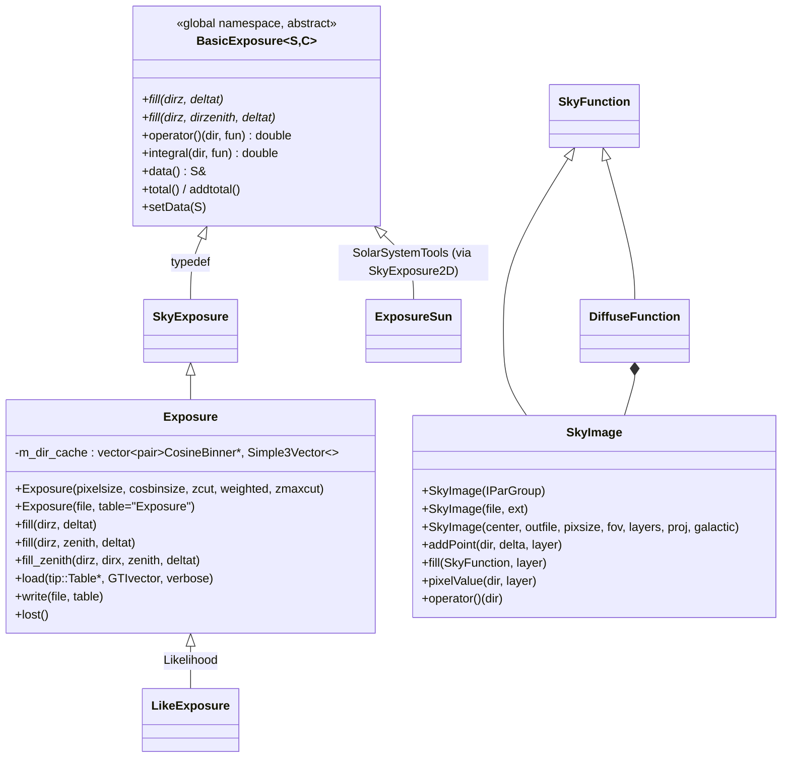

# map_tools Architecture

**map_tools** is a small, mostly 2005–2010 package (original author
T. Burnett). Only one part of it is on the critical path of the
standard analysis: **`map_tools::Exposure`**, the HEALPix ×
cos(θ) [× φ] livetime-cube container. `Likelihood::LikeExposure`
(which `gtltcube` uses) derives from it. `Likelihood::ExposureCube` (which
every exposure, source-map and `gtexpcube2` calculation uses) reads the
`EXPOSURE` and `WEIGHTED_EXPOSURE` tables of a livetime cube into two
`map_tools::Exposure` objects. Most of the rest of the package is legacy
code: one helper with no users, parameter classes used only by tools that
are no longer built, and two built tools that are not part of the
documented tool set.

The Doxygen mainpage (`src/mainpage.h`, 2005) lists `count_map`,
`exposure_map`, `read_map` and `map_stats`, and names `HealpixArray`,
`CosineBinner` and `HealpixArrayIO` as map_tools classes. **All of this
is stale**: those four tools are not built, and the three classes moved to
the `healpix` package long ago. There is no `ExposureHyperCube` class.
`doc/release.notes` ends in 2014.

## Purpose and scope

**Does:**
- Define `Exposure`: a `healpix::HealpixArray<healpix::CosineBinner>`
  (one livetime histogram in cos θ, and optionally φ, per sky pixel)
  that can be filled from FT2 rows, with optional zenith-angle cuts and
  livetime-fraction weighting, and read and written through
  `healpix::HealpixArrayIO`.
- Define the template `BasicExposure<S, C>`, which `SolarSystemTools`
  reuses with its own cell type.
- Define `SkyImage`: a float FITS image (2-D or layered 3-D) with an
  `astro::SkyProj` WCS. You can fill it point by point or from an
  `astro::SkyFunction`, and look up values by `SkyDir`.
- Build two executables: `exposure_cube` (FT2 → livetime cube) and
  `gtdispcube` (debug dump of one pixel of a livetime cube).

**Does not:**
- Compute exposure maps (Aeff × livetime) or count maps. `gtexpcube2`
  and `gtexpmap` (Likelihood) and `gtbin` (evtbin) do that. The old
  `exposure_map` and `count_map` sources are still here but are not built.
- Own the livetime-cube file format. The `CosineBinner` cell, its
  process-wide static binning, and `HealpixArrayIO` belong to `healpix`.
  `gtltcube` writes its file through `Likelihood::LikeExposure`, not
  through map_tools (see `src/healpix/doc/architecture/`).
- Use any IRFs. The `irfLoader` link is left over from the unbuilt
  `exposure_map` tool.

## Position in the system

| Direction | Package | Why |
|-----------|---------|-----|
| Depends on | `healpix` | `Exposure` *is* a `HealpixArray<CosineBinner>`. File I/O goes through `HealpixArrayIO`. |
| Depends on | `astro` | `SkyDir`, `PointingTransform` (φ binning), `SkyProj` and `SkyFunction` (`SkyImage`). CLHEP types (`Hep3Vector`, `HepRotation`) come in through `astro`'s headers. |
| Depends on | `tip` | FT2 rows in `Exposure::load`. Image I/O in `SkyImage`. |
| Depends on | `hoops` | `SkyImage(const hoops::IParGroup&)`. `Parameters` and `MapParameters` wrap or derive from `hoops::ParPromptGroup`. |
| Depends on | `st_app`, `st_stream` | Used only by the two executables. They are linked `PUBLIC` on the library, so every consumer inherits them. |
| Depends on | `facilities` | Only `gtdispcube` and the test use it (`Util::expandEnvVar`), and they get it transitively through `tip`. It is not linked directly. |
| Link only | `irfs` (`irfLoader`) | `target_link_libraries(map_tools PUBLIC ... irfLoader)`, but no compiled source includes `irfInterface` or `irfLoader`. Only the unbuilt `src/exposure_map/exposure_map.cxx` does. |
| Used by | `Likelihood` | `LikeExposure : map_tools::Exposure` (gtltcube fills it with `fill`/`fill_zenith`). `ExposureCube` holds `map_tools::Exposure *m_exposure, *m_weightedExposure`, read with `Exposure(filename[, "WEIGHTED_EXPOSURE"])`, and reads livetimes through `data()[dir]`. |
| Used by | `SolarSystemTools` | `ExposureSun.h` uses only the global-namespace `BasicExposure<S, C>` template, instantiated with its own `HealpixArray<CosineBinner2D>`. It does not use `map_tools::Exposure` itself. |
| Used by | `pyLikelihood` | SWIG `%include`s `map_tools/Exposure.h` and `map_tools/SkyImage.h`, and adds `Exposure.data(SkyDir)` with `%extend`. It links map_tools through Likelihood. |
| Not built | `celestialSources/DarkMatter/src/makeMap.cxx` (uses `SkyImage`), `skymaps` (`LivetimeCube` is a 2008 copy of `Exposure`) | Neither is compiled by CMake. |

The tier in `docs/architecture/dependency-layers.md` (`analysis`) is
acceptable, but it comes from the stale `irfLoader` link. Going by what
the code actually uses, map_tools needs only tier 0 and 1 packages
(`healpix`, `astro`, `tip`, `hoops`, plus `st_app`/`st_stream` for the
tools). Removing the `irfLoader` link would let it sit in the `io` tier
and would remove the `map_tools → irfs` edge from the dependency graph.

## Key abstractions



| Type | Header | Role |
|------|--------|------|
| `BasicExposure<S, C>` | `map_tools/Exposure.h` | Template over a pixelization `S` (indexable by `SkyDir`) and a per-pixel angular binner `C`. Holds the sky array and a running `total()` of time added. **Declared in the global namespace**, as are the typedefs `SkyBinner` (= `healpix::HealpixArray<healpix::CosineBinner>`) and `SkyExposure`. |
| `map_tools::Exposure` | `map_tools/Exposure.h` | The livetime cube. NESTED, equatorial HEALPix. `nside` is the power of 2 for which `12·nside² ≥ 41252/pixelsize²`, capped at 512 (`pixelsize=1` gives nside 64). Fill routines add `deltat` to each pixel's `CosineBinner` at that pixel's cos θ (and φ) relative to the spacecraft axes. A private `m_dir_cache` holds (cell pointer, unit vector) pairs so that filling is a tight dot-product loop. |
| `SkyImage` | `map_tools/SkyImage.h` | Float FITS image with WCS, written to disk in the **destructor**. Layers carry energies (`getEnergies`) when built from parameters or from a counts map's EBOUNDS. |
| `DiffuseFunction` | `map_tools/DiffuseFunction.h` | `SkyFunction` over a 17-layer, 2^k energy-spaced diffuse cube held in a `SkyImage`, plus an analytic extragalactic power law. It is compiled into the library but **nothing uses it**. |
| `Parameters`, `MapParameters` | `map_tools/Parameters.h`, `MapParameters.h` | hoops-based parameter readers for the old tools. They are compiled into the library, but **only unbuilt tools use them**. |

## Data flow and control flow

### Filling a livetime cube (`Exposure::load`, used by `exposure_cube`)

```
Exposure(pixelsize, cosbinsize, zcut, weighted, zmaxcut)
  HealpixArray(Healpix(nside, NESTED, EQUATORIAL))      // one CosineBinner per pixel, sized from the static binning
  if 1/cosbinsize != CosineBinner::nbins():
      resize every cell; CosineBinner::setBinning(0, 1/cosbinsize)   // process-wide static
  create_cache()                                        // (cell*, pixel unit vector) for every pixel

load(scTable, gti, verbose)
  for each FT2 row:
      livetime == 0 → skip                              // "takes care of SAA"
      fraction = overlap of [START,STOP) with the first GTI it touches
      deltat   = LIVETIME × fraction  (× LIVETIME/(STOP−START) if weighted)
      fill_zenith(SCZ, SCX, ZENITH, deltat)
         for each pixel: if zcut < pixel·zenith < zmaxcut (or no cut):
              phi binning on  → CosineBinner::fill(cosθ, φ, deltat) in instrument frame (PointingTransform)
              phi binning off → CosineBinner::fill(pixel·SCZ, deltat)
```

`Likelihood::LikeExposure::load` (gtltcube) does **not** call
`Exposure::load`. It has its own FT2 loop with full GTI handling and
calls `fill`/`fill_zenith` on itself and on a second, weighted
`map_tools::Exposure`. Changes to the `Filler` logic in `Exposure.cxx`
therefore change gtltcube output. Changes to `load`/`processEntry` affect
only `exposure_cube`.

### Reading a livetime cube

`Exposure(file, table)` calls `HealpixArrayIO::read`. That **resets the
process-wide `CosineBinner` binning** (`NBRBINS`, `COSMIN`, `THETABIN`,
`PHIBINS`) from the file header, then replaces the pixel array.
`Likelihood::ExposureCube` then calls `exposure->data()[dir]` to get one
pixel's `CosineBinner`, and integrates Aeff over it.

### `exposure_cube`

Prompts for `infile` (FT2), `outfile`, `tstart`, `tstop` and `zmin`. It
sets `CosineBinner::setPhiBins(phibins)` (default **15**). It builds an
unweighted and a weighted `Exposure` (pixelsize 1°, cos-bin 0.025, so 40
bins), loads both from FT2 with a single GTI `[tstart, tstop]`, and writes
the `Exposure` and `WEIGHTED_EXPOSURE` tables with `HealpixArrayIO`.
Text-format (`.txt`) pointing input throws "not currently implemented".

### `gtdispcube`

It reads a livetime cube into an `Exposure`. The code that would build a
`SkyImage` and write `outfile` is inside `#if 0`. What the tool actually
does is write **`test_table.txt` in the current directory**: one line per
cos θ bin, giving the livetime at the image centre (`xref`, `yref`), with
one column per φ bin. `outfile`, `nxpix`, `nypix`, `pixscale`, `proj` and
`clobber` are read or prompted but have no effect.

## Public interfaces

### C++ library

The headers consumers actually use are `map_tools/Exposure.h`
(Likelihood, SolarSystemTools, pyLikelihood) and `map_tools/SkyImage.h`
(pyLikelihood SWIG only). `Exposure.h` pulls in
`healpix/HealpixArray.h` and `healpix/CosineBinner.h`.

Typical read-only use (what `Likelihood::ExposureCube` does):

```cpp
map_tools::Exposure lt("ltcube.fits");                          // table "Exposure" (case-insensitive: EXPOSURE)
map_tools::Exposure wlt("ltcube.fits", "WEIGHTED_EXPOSURE");
const healpix::CosineBinner & cell = lt.data()[astro::SkyDir(ra, dec)];
double t = lt(astro::SkyDir(ra, dec), aeff_of_costheta);       // Σ_bins livetime × f(cosθ)
```

### Applications

| Tool | Built | Par file | Notes |
|------|-------|----------|-------|
| `exposure_cube` | yes | `pfiles/exposure_cube.par` | Not a `gt` tool, and not wrapped by `sane` or described in `fermitools-fhelp`. Superseded by `gtltcube` (Likelihood). |
| `gtdispcube` | yes | `pfiles/gtdispcube.par` | Debug dump only (see above). No fhelp page. |
| `test_map_tools` | yes (installed to `bin/`) | `pfiles/test_map_tools.par` | Test program. |
| `count_map`, `exposure_map`, `map_stats`, `read_map`, `cube_display` | **no** | par files for all five are still installed to `syspfiles` | `count_map.cxx` includes ROOT's `TSystem.h`. `exposure_map.cxx` needs `irfInterface` and `dataSubselector`. `cube_display.par` is an older copy of `gtdispcube.par` with different parameter names (`numxpix`/`numypix`). |

### Python

There is no module of its own. `pyLikelihood` exposes `Exposure`
(including the `fill*`, `write` and `load` methods) and `SkyImage`, so
Python users can create a `SkyImage` (it writes a file when it is garbage
collected). The `%extend` method `Exposure.data(SkyDir)` returns one
`CosineBinner`, but **it copies the whole `HealpixArray` on every call**
(`pyLikelihood/src/pyLikelihood.i`), which costs roughly
npix × nbins × 4 bytes per call.

### File formats

- **Exposure tables** (written by `HealpixArrayIO`): one row per HEALPix
  pixel with a `COSBINS` vector column. The header has
  `ORDERING=NESTED`, `COORDSYS`, `NSIDE`, `FIRSTPIX`/`LASTPIX`,
  `THETABIN`, `NBRBINS`, `COSMIN` and `PHIBINS`. `exposure_cube` writes
  **no TSTART/TSTOP, GTI or CTHETABOUNDS**, unlike `gtltcube`.
- **SkyImage**: a float image extension named `skyimage`, appended to
  `outfile`, with WCS keywords from `astro::SkyProj::setKeywords`.
- `Templates/CountMap` and `Templates/ExposureCube.txt` are not installed
  and nothing reads them.

### Environment variables

None are read directly (`grep getenv` finds nothing).
`facilities::Util::expandEnvVar` expands `$(VAR)` in `gtdispcube` file
names and in Likelihood's `ExposureCube`.

## Build and test

- **CMake target:** `map_tools` is a **STATIC** library, compiled from 5
  sources (about 900 lines). Upstream commit `83a6110` switched it to
  `SHARED` and `a3cf7cb` switched it back. Executables: `exposure_cube`,
  `gtdispcube`, `test_map_tools`. About 780 lines in
  `count_map/`, `exposure_map/`, `map_stats/` and `read_map/` are never
  compiled.
- **Install:** headers go to `include/map_tools`, `pfiles/` goes to
  `syspfiles` (including the par files of the unbuilt tools), and the
  three executables go to `bin/`. There is **no `data/` directory**, so
  `getDataPath("map_tools")` is never used.
- **`test_map_tools`:**
  - It is a plain `main()` that uses `hoops::ParPromptGroup`, so `PFILES`
    must find `test_map_tools.par`. It is **not registered with CTest**.
  - It checks that `xref` reads as 0. It fills a 10°-pixel, 10-bin
    `Exposure` with a uniform grid, writes it to `infile`
    (`testCube.fits`, in the current directory), reads it back, and writes
    it again to `outfile` (`testCube2.fits`). It then runs
    `TestCosineBinner`, which compares linear and sqrt cos θ binning
    integrals and **changes the static binning**.
  - **All numerical checks of `Exposure` are inside `#if 0`.** Apart
    from `TestCosineBinner`, the test only checks that nothing throws.
  - The external `recipe/tests/ST-unit-test` (`check_test_map_tools_output`)
    checks that both files exist. With its `bit64` option it also runs
    `ftdiff` against `$CONDA_PREFIX/share/fermitools/data/map_tools/outref/testCube_64bit.fits`,
    but this package has no `outref` data and installs none.
- **Legacy:** `SConscript`, `map_toolsLib.py` and `doc/Doxyfile` belong to
  the SCons/CMT era. `azure-pipelines.yml` is old CI.
- **Branches:** `origin/f26-cpp17-compliance` has small C++17 fixes to
  `cube_display.cxx` and `test_main.cxx`. `origin/Issue17` makes the
  library type optional. `origin/addition_creator_fits` edits only the
  unused `Templates/`. None of them is merged.

## Invariants and gotchas

**Global state shared with healpix and Likelihood**
- `CosineBinner` binning (`nbins`, `cosmin`, sqrt or linear, `nphibins`)
  is **static and process-wide**. `Exposure(pixelsize, cosbinsize, …)`
  calls `CosineBinner::setBinning(0, 1/cosbinsize)` only when the bin
  count changes, and in that case it also resets sqrt weighting to the
  default `true`. `Exposure(file)` resets everything from the file
  header. Construct a second cube with different binning in the same
  process and the first one's cells will be interpreted with the wrong
  binning. Phi binning must be enabled with
  `CosineBinner::setPhiBins(n)` **before** an `Exposure` is constructed,
  because the cells are sized at construction.
- `BasicExposure`, `SkyBinner` and `SkyExposure` are in the **global
  namespace**. `SolarSystemTools` defines more global typedefs
  (`SkyBinner2D`, `SkyExposure2D`) next to them.

**Exposure construction and copying**
- `Exposure(file, table)` leaves `m_zcut`, `m_zmaxcut`, `m_lost` and
  `m_weighted` **uninitialized**, and it does not build `m_dir_cache`.
  A cube read from a file therefore cannot be filled: `fill()` adds to
  `total()` but touches no pixel. `lost()` is garbage. `total()` is 0,
  because the total time is not stored in the file (this is the "broken"
  total in `gtdispcube`'s `#if 0`).
- The implicitly generated copy constructor copies `m_dir_cache`, which
  holds **pointers into the source object's pixel array**. Filling a
  copy writes into the original, or into freed memory if the original
  has been destroyed. Copies made by `Likelihood` (`ExposureCube` copy
  constructor, `LikeExposure` copy constructor) are safe only as long as
  nobody fills them (from reading the code; not checked at runtime).
- `setData()` replaces the array without rebuilding the cache, with the
  same consequence.

**Filling from FT2 (`Exposure::load`, used only by `exposure_cube`)**
- **Possible crash (from reading the code):**
  `irow % (nrows/20)` divides by zero when the FT2 table has fewer than
  20 rows and `verbose` is true (the default).
- An FT2 interval is credited only for its overlap with the **first** GTI
  it touches. If an interval spans a gap between two GTIs, the overlap
  with the second GTI is lost. `exposure_cube` passes a single GTI, so
  this does not affect it.
- Rows with `LIVETIME == 0` are skipped, which is how SAA passages are
  handled.
- Zenith cut: a pixel is used only if `zcut < cos(zenith angle) <
  zmaxcut`. Both bounds are exclusive, and `zcut = -1, zmaxcut = 1` means
  no cut. The time that is cut is accumulated in `lost()`.
- "Weighted" means the livetime is multiplied by the livetime fraction
  `LIVETIME/(STOP−START)`. This is the `WEIGHTED_EXPOSURE` used for the
  livetime-dependent efficiency correction in Likelihood.

**`exposure_cube` tool**
- It opens the FT2 file with `editTable` (**read-write**), so a
  read-only FT2 file fails, and it never deletes the table.
- `filter` is prompted and `avoid_saa` is declared, but neither is used.
  `tstart`/`tstop` have no defaults. `phibins` defaults to 15, unlike
  `gtltcube`'s default of 0.
- The output has no `TSTART`/`TSTOP` keywords. `Likelihood::ExposureCube`
  reads `TSTART` from the `EXPOSURE` header, so **exposure_cube output
  probably cannot be used as a gtltcube replacement** (from reading the
  code; not checked at runtime).

**SkyImage**
- Data is written only in the **destructor** (`m_save` is true for newly
  created images). An exception thrown during the write escapes a
  destructor, and the file is incomplete until the object is destroyed.
- `SkyImage(file, ext)` opens the image **read-write** (`editImageFlt`)
  but never writes it back. It requires a 3-D image, because reading
  `NAXIS3` throws for a 2-D file. `m_total` and the other statistics are
  left uninitialized.
- The "NaN" used to fill pixels outside the projection is built by type
  punning `unsigned long lnan[2] = {0xffffffff, 0x7fffffff}`. On LP64
  systems each `unsigned long` is 8 bytes, so the resulting double is a
  tiny denormal (about 2e-314), **not NaN** (from reading the code; not
  checked at runtime).
- Pixel lookup is not consistent. `addPoint` truncates the projected
  coordinate directly, while `pixel_index` and `getNeighbors` subtract
  0.5 first, which is a half-pixel offset between the two. The bounds
  check in `pixel_index` is `k > m_pixelCount+1`, which lets two
  out-of-range indices through. Negative projected coordinates are
  wrapped by adding `naxis`.
- In the `(center, outfile, …)` constructor with `fov > 90`, if `ptype`
  is not `CAR`, `AIT` or `ZEA`, the test `m_naxis1 == 0` reads an
  uninitialized member.
- Layer energies come from the counts map's `EBOUNDS` converted
  **keV → MeV** (×0.001), or are generated from `emin`/`emax` in MeV.
  `bincalc=CENTER` gives N layers at bin centres. Any other value gives
  N+1 layers at the bin edges.

**DiffuseFunction (unused)**
- `operator()` adds the extragalactic term only when interpolating
  between layers (`m_fract != 0`). `integral(dir, const Aeff&, a, b)` is
  declared but never defined, so calling it fails at link time.
  `layers()` is hard-coded to 17.

## Extension points

- **Livetime-cube changes** belong in `healpix` (cell layout and I/O) and
  `Likelihood` (`LikeExposure`, `ExposureCube`), not here. If you change
  `Exposure`'s fill logic, re-run the Likelihood and SolarSystemTools
  tests and compare `gtltcube` output, because `LikeExposure` inherits
  the `Filler`.
- **Fixing the copy constructor** (rebuilding `m_dir_cache` after copy or
  `setData`) is the main robustness change worth making if `Exposure` is
  ever filled after being copied.
- **Retiring dead code:** the unbuilt tool directories and their par
  files, `Parameters`/`MapParameters`/`DiffuseFunction`, `Templates/`, and
  the `irfLoader` link can be removed without affecting any built
  consumer. `SkyImage` must stay while `pyLikelihood` wraps it.
- **A new tool** would follow the `st_app` pattern used by
  `exposure_cube.cxx` (see `src/st_app/doc/architecture/`): add an
  `add_executable` and a par file.

## Further reading

- `src/healpix/doc/architecture/`: `CosineBinner`, `HealpixArray`,
  `HealpixArrayIO`, and the livetime-cube file format.
- `src/Likelihood/` (`LikeExposure`, `ExposureCube`,
  `makeExposureCube/`): how the analysis builds and reads livetime cubes.
- `src/st_app/doc/architecture/` and `src/ape/doc/architecture/parameter-files.md`:
  tool startup and par files.
- `src/mainpage.h` and `doc/release.notes`: history only, and stale.
